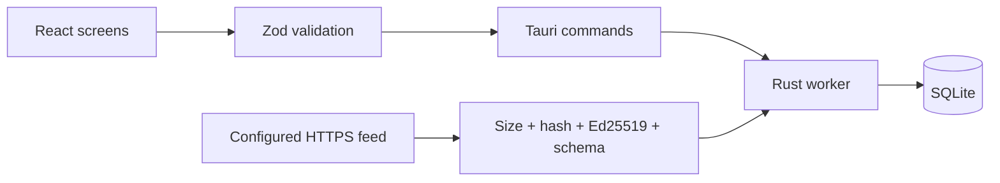

# 🏗️ How the app fits together

React owns navigation and renders validated data. Shared hero, map, and selection controls live in `src/components`. The domain layer handles schemas, search, deterministic recommendations, and the desktop bridge.

Rust owns the desktop database and content downloads. Tauri commands run database, file, and network work in blocking worker tasks. The WebView receives JSON, not file paths or database handles. No shell, arbitrary file-write, or general HTTP plugin is exposed to the UI.

## 🔄 Data flow

App version, content version, game patch, and database schema version are separate. The candidate's game patch is explicitly unverified.

SQLite schema v2 contains source, hero, ability, map, matchup, synergy, map-fit, and content-package tables. Foreign keys protect relationships. Personal data has its own table and revision counter. The v1 → v2 migration adds relationship tables without replacing personal data. Competing window saves fail explicitly rather than silently overwriting each other. Content replacement runs in a transaction and retains one previous package. A failed install leaves the active package and personal data untouched.

Window state is saved separately by the Tauri window-state plugin, by window label. Portable builds direct that file to their own data folder. Main and Quick Reference sizes and positions are independent. Native DPI and monitor recovery still need Windows GUI validation.

User backups have a strict schema. Import replaces personal data only after validation; content is not imported through this path. Unknown future schemas are rejected. Old v0 backups are migrated in memory before saving.

## 🧠 Recommendation rules

Reviewed matchup edges contribute −2, 0, or +2 points. Team edges and map fit contribute −1 or +1. The UI shows every contributing explanation. Unknown interactions contribute no evidence, not an assumed neutral result. Heroes with no evidence remain unranked. Roles filter candidates; selected allies are not recommended again.

Scores describe editorial tactical evidence. They are not win probabilities. Stale content is excluded by default; opting in lowers displayed confidence. The snapshot has no reviewed map-fit edges.

## 🛡️ Trust boundaries

A content package must pass the shared JSON Schema and Rust reference checks. Downloads use HTTPS, bounded sizes, a deadline, and no redirects. The manifest and package must use the same origin. Hashes detect damaged bytes; a compiled-in Ed25519 key authenticates the exact package bytes. A newer signed version must match the manifest before installation.

No publisher key is supplied in this candidate. Content update controls report that prerequisite rather than contacting a fake service. Do not configure untrusted endpoints: a signed package authenticates content but does not make a hostname private or safe. A full DNS rebinding defense and independently reviewed network threat model remain release work.

The CSP blocks remote scripts, frames, fonts, and images. React renders content as text, not HTML. Tauri capabilities grant only the listed core event/window operations. There are no remote WebView capabilities. Source links use a Rust command that validates HTTPS and checks the active source list before handing the URL to the OS browser. The opener plugin has no frontend permissions.
